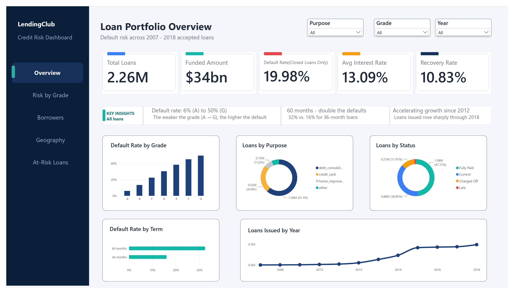
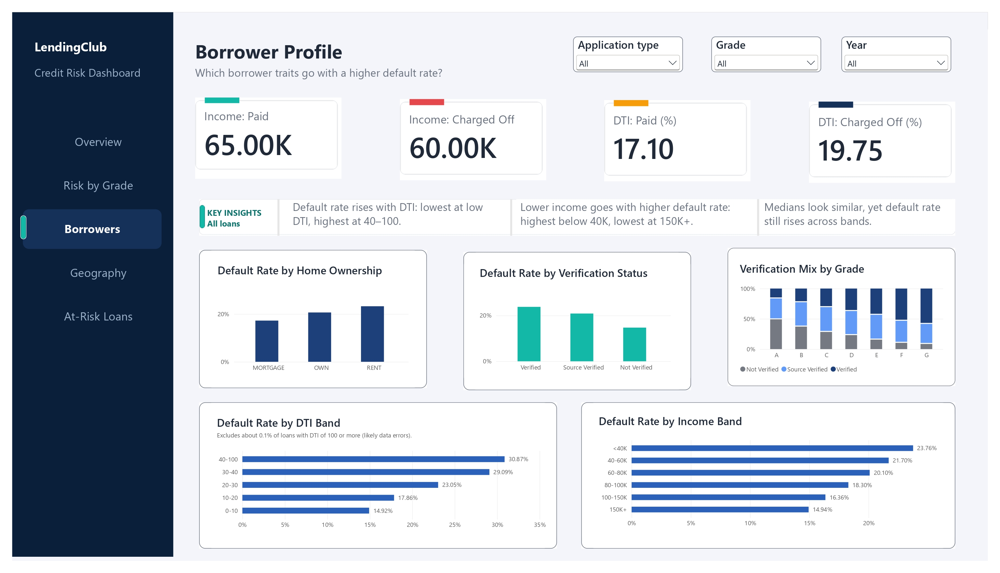
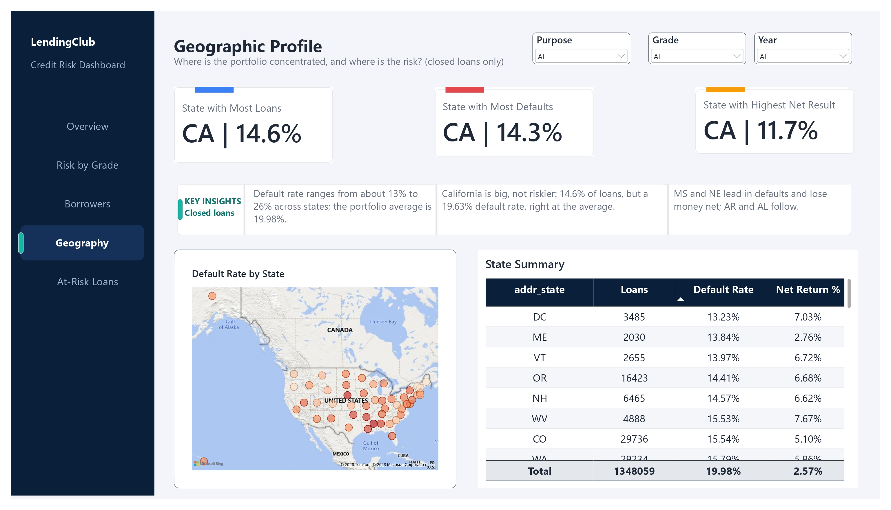

# 💳 Lending Club Credit Risk: Dashboard and Default Prediction

An analysis of 2.26 million Lending Club loans (2007 to 2018 Q4), in three parts:

1. 🧹 Cleaning and preparing the raw data.
2. 📊 A 5-page Power BI dashboard on the portfolio, grades, borrowers, geography and at-risk loans.
3. 🤖 A LightGBM model that estimates default risk for loans that are still open, with the predictions fed back into the dashboard.

The model reaches an AUC of 0.72 on a held-out year (2016). Loans in its riskiest decile defaulted at 52.8%, against 4.1% in the safest decile.

---

## 📊 Dashboard

### 🏠 Overview
Portfolio size, default rate (closed loans), interest and recovery rates.



### ⚖️ Risk by Grade
Does the interest charged on riskier grades cover their losses?


### 👥 Borrowers
Default rate by income, DTI, home ownership and verification status.



### 🗺️ Geography
Portfolio concentration and default rate by state.



### 🚨 At-Risk Loans
Uses the model output to show which open loans look risky and how much principal is exposed.


---

## 🗂️ Data

Source: [Lending Club dataset on Kaggle](https://www.kaggle.com/datasets/wordsforthewise/lending-club) (`accepted_2007_to_2018Q4.csv`, 2,260,701 rows and 151 columns).

The data and the files generated from it are not uploaded because of their size.

- `Loan_Data_Exploration_and_Analysis.ipynb` prepares the data for Power BI and writes `loans_dashboard.csv`.
- `loan-default-prediction-modeling.ipynb` trains the model and writes `predictions_for_powerbi.csv`. Running it recreates the predictions file.
- `analysis.pbit` is the Power BI template without data. Point it to the two CSV files and relate them on `id`.

---

## 📁 Repository structure

```
.
├── README.md
├── Analysis & Dashboard/
│   └── analysis.pbit
├── notebooks/
│   ├── Loan_Data_Exploration_and_Analysis.ipynb
│   └── loan-default-prediction-modeling.ipynb
├── color template/
│   └── lending_club_theme.json
└── Screenshots/
    ├── Overview.jpg
    ├── Risk by Grade.jpg
    ├── Borrowers.jpg
    ├── Geography.jpg
    └── At-Risk Loans.jpg
```

---

## 🧪 Methodology

### Data exploration for Power BI

- An exploratory notebook: profiled missing values in every column and checked why some are empty only in certain years (some credit fields only start in later years) instead of filling them blindly.
- Cleaned the fields the dashboard uses, for example missing `emp_title` set to `Unknown`.
- Exported a 27-column table for the dashboard, including the payment and recovery columns used to calculate losses and net return on closed loans.
- The cleaning that feeds the model is done in the modeling notebook, described below.

### Default model

- **Target:** `Fully Paid` = 0 and `Charged Off` = 1, which gives 1,348,059 closed loans with a 19.98% default rate. Open loans (`Current`, `Late`, `In Grace Period`, `Default`) have no outcome yet, so they are kept aside and scored at the end (912,609 loans).
- **Missing columns:** dropped 39 columns that were 50% or more empty. Five `mths_since_*` columns were kept, because there an empty value means the event never happened (for example, no delinquency ever), which is information in itself.
- **Leakage:** removed 15 columns that are only known after a loan starts, such as `total_pymnt`, `recoveries`, `last_pymnt_d` and `out_prncp`.
- **Features:** 82 in total. `sub_grade` mapped from A1 to G5 onto 0 to 34, `credit_age_years` engineered from the dates, `grade` dropped because `sub_grade` contains it, and `zip_code` dropped (945 values). Remaining missing values are left as they are, since LightGBM handles them natively and filling them would invent data.
- **Split by time, not randomly**, because the model is applied to loans issued after the ones it learns from:

| Set | Years | Loans | Default rate |
|---|---|---|---|
| Train | 2007 to 2014 | 453,808 | 17.0% |
| Validation | 2015 | 375,545 | 20.2% |
| Test | 2016 | 293,095 | 23.3% |

- **Why not evaluate on 2017 and 2018:** most of those loans are still open (62% and 89%), so the closed ones are mostly early payers and early defaulters. That makes their default rate look artificially low. The share still open is already 32.5% for 2016, so the 2016 result is approximate.
- **Model:** LightGBM with early stopping on validation AUC (321 trees), then retrained on all closed loans with 353 trees to score the open loans.
- XGBoost and CatBoost gave nearly identical AUC. Class weighting lowered it, so it was not used.

---

## 📈 Results

| | AUC |
|---|---|
| Validation, 2015 | 0.7444 |
| Test, 2016 | 0.7229 |

- **Ranking works.** On the 2016 test year, the actual default rate rises in every one of the 10 risk groups, from 4.1% in the safest to 52.8% in the riskiest.
- **Open loans:** the 912,609 open loans have an average predicted default probability of 21.4%.
- **Sanity check:** the model never sees payment behaviour, yet loans that are already 31 to 120 days late sit mostly in the high-risk groups. About 54% of them fall in the three riskiest deciles, against about 29% of current loans.

---

## ⚠️ Limitations

- The predicted probabilities are lower than the actual default rate. The model learned from earlier years with lower default rates, so use the risk deciles to compare loans rather than reading `p_default` as an exact probability.
- Loans from 2016 to 2018 are partly still open, so their outcomes are incomplete.
- The model sees loan details at issue time only, so a loan that is already late is scored like any other loan with the same profile. The dashboard shows past-due loans separately.
